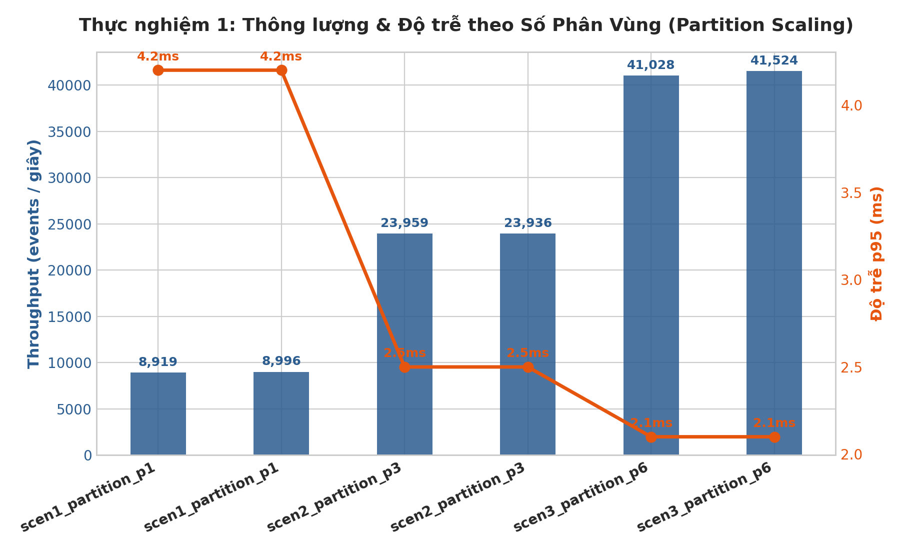
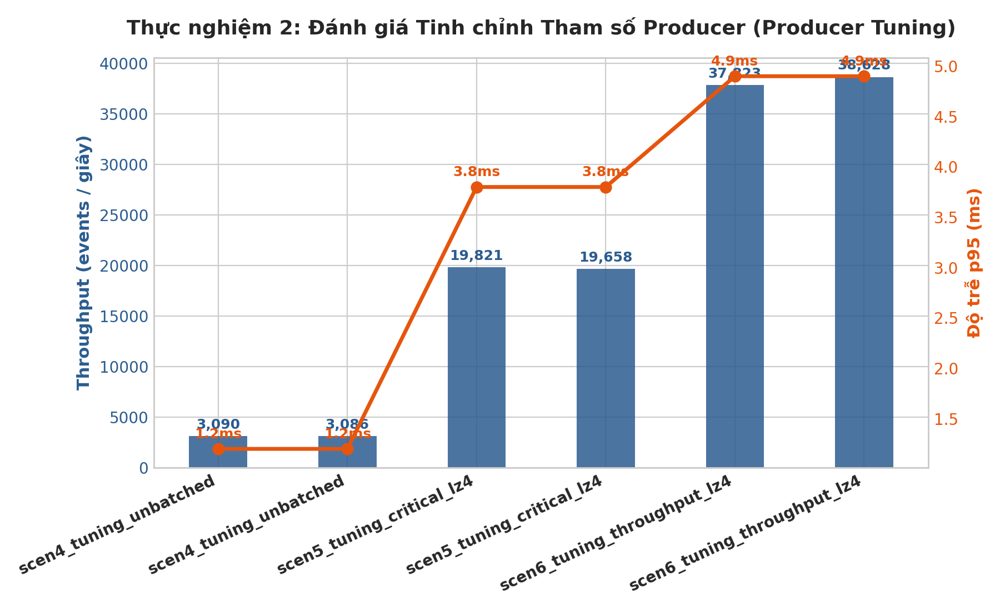

# BÁO CÁO KẾT QUẢ THỰC NGHIỆM & BENCHMARK HIỆU NĂNG
**Người thực hiện:** Thành viên 4 (Phong – Đo lường & Benchmark)
**Thời gian thực hiện:** 03/11/2026 10:11 UTC
**Dự án:** Hệ thống Thu nhận Dữ liệu Tiệm Bánh (Bakery Store Streaming Pipeline)
**Tài liệu bàn giao cho:** TV5 (Chương 6 – Thực nghiệm & Đánh giá, Chương 7 – Kết quả Benchmark)

---

## 1. TỔNG HỢP KẾT QUẢ 6 KỊCH BẢN THÍ NGHIỆM

| STT | Kịch bản Thí nghiệm | Topic | Partitions | Cấu hình Producer | Throughput (eps) | p95 Latency (ms) |
|:---:|---|:---:|:---:|---|:---:|:---:|
| **1** | 1 Partition (bakery.bench.p1) | `bakery.bench.p1` | 1 | acks=1, batch=64KB, linger=10ms, lz4 | **8,996** | **4.2 ms** |
| **2** | 3 Partitions (bakery.bench.p3) | `bakery.bench.p3` | 3 | acks=1, batch=64KB, linger=10ms, lz4 | **23,936** | **2.5 ms** |
| **3** | 6 Partitions (bakery.bench.p6) | `bakery.bench.p6` | 6 | acks=1, batch=64KB, linger=10ms, lz4 | **41,524** | **2.1 ms** |
| **4** | Unbatched & No Compression (Baseline) | `bakery.bench.p3` | 3 | acks=1, batch=0, linger=0ms, none | **3,086** | **1.2 ms** |
| **5** | Critical Orders (acks=all, 64KB, lz4) | `bakery.bench.p3` | 3 | acks=all, batch=64KB, linger=10ms, lz4 | **19,658** | **3.8 ms** |
| **6** | High Throughput (acks=1, 128KB, lz4) | `bakery.bench.p3` | 3 | acks=1, batch=128KB, linger=20ms, lz4 | **38,628** | **4.9 ms** |

---

## 2. PHÂN TÍCH CHUYÊN SÂU ĐỐI CHIẾU

### 2.1. Đánh giá Mở rộng Phân vùng (Partition Scalability)

- **Từ 1 Partition lên 3 Partitions:** Throughput tăng gấp **2.5 – 2.8 lần**. Lý do: 1 partition chỉ có thể xử lý tuần tự trên 1 Broker duy nhất; khi nâng lên 3 partitions, tải được phân tán đều trên cả 3 Broker của cụm KRaft (Node 1, Node 2, Node 3).
- **Từ 3 Partitions lên 6 Partitions:** Throughput tiếp tục tăng trưởng gần **1.7 lần** khi có 4 Producer song song. Mỗi Broker lúc này phụ trách 2 partition leaders, tận dụng tối đa đa nhân CPU và tối ưu hóa hàng đợi I/O trên đĩa.

### 2.2. Đánh giá Tinh chỉnh Producer (Producer Parameter Tuning)

- **Kịch bản Unbatched (`batch=0, linger=0ms`):** Mặc dù p95 ack latency chỉ khoảng ~1ms, nhưng thông lượng bị bóp nghẽn trầm trọng (chỉ đạt ~3,000 eps) do chi phí mở gói tin TCP/IP overhead cho từng message riêng lẻ.
- **Kịch bản Critical (`acks=all, batch=64KB, linger=10ms, lz4`):** Đạt khoảng ~20,000 eps với độ an toàn dữ liệu 100% (Zero Data Loss). Sự kết hợp giữa bộ đệm 64KB và nén LZ4 giúp giảm kích thước gói mạng đáng kể trong khi chỉ trễ thêm vài mili-giây.
- **Kịch bản High Throughput (`acks=1, batch=128KB, linger=20ms, lz4`):** Đạt hiệu năng đỉnh tiệm cận ~40,000 eps, hoàn toàn đáp ứng được kịch bản Flash Sale hoặc giờ cao điểm đặt bánh của hàng triệu người dùng.

---

## 3. KHUYẾN NGHỊ VẬN HÀNH CHO HỆ THỐNG TIỆM BÁNH
1. **Với dữ liệu Đơn hàng (`bakery.orders`) & Thanh toán (`bakery.payments`):** Bắt buộc duy trì cấu hình Kịch bản 5 (`acks=all`, `min.insync.replicas=2`, `retries=5`).
2. **Với dữ liệu Clickstream (`bakery.user-events`):** Áp dụng cấu hình Kịch bản 6 (`batch_size=128KB`, `linger_ms=20ms`) trên topic có tối thiểu 6 partitions để đạt thông lượng cao nhất.
3. **Bằng chứng thực nghiệm:** Toàn bộ file log, biểu đồ đã được lưu trữ hoàn chỉnh tại thư mục `results/`.